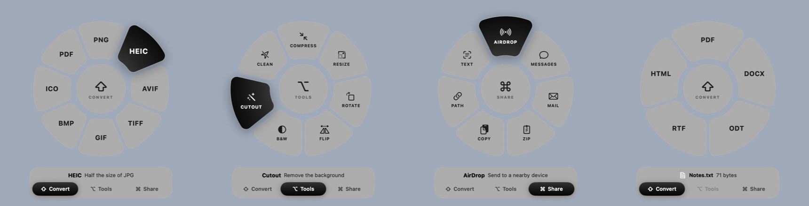
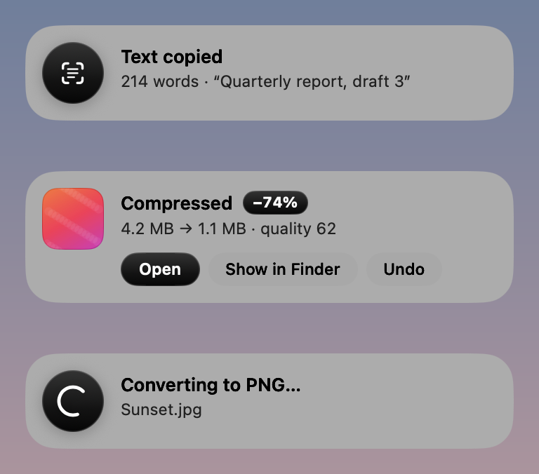

# MetaDrag

Конвертируй, редактируй и отправляй файлы прямо во время перетаскивания. Начни тянуть файл в Finder, нажми клавишу, и под курсором раскроется кольцо из настоящего Liquid Glass (macOS 26). Отпусти файл на нужный лепесток.



## Режим зависит от клавиши

| Клавиша | Кольцо | Что внутри |
|---|---|---|
| **⇧ Shift** | Convert | Картинки → PNG, JPG, HEIC, AVIF, TIFF, GIF, BMP, ICO, PDF (несколько картинок → один PDF) · PDF → JPG/PNG/HEIC постранично, TXT, DOCX, RTF · Документы (DOCX, ODT, RTF, TXT, MD, HTML…) → PDF, DOCX, ODT, RTF, TXT, HTML |
| **⌥ Option** | Tools | Картинки: Compress, Resize 50%, Rotate, Flip, B&W, **Cutout** (удаление фона через Vision), **Clean** (убрать GPS/камеру/дату) · PDF: Compress, Rotate, Split, Merge, Lock (пароль) |
| **⌘ Command** | Share | AirDrop, Messages, Mail, Zip, Copy, Path, **Text** (OCR картинок и сканов, текст сразу в буфер) |

- Пока кольцо открыто, нажми другую клавишу, и кольцо перетечёт в её режим. Ещё можно навести файл на переключатель `⇧ ⌥ ⌘` внизу.
- Клавишу можно отпустить до того, как бросишь файл: режим сохранится.
- Чтобы отменить, уведи файл за пределы кольца или отпусти его в центре.
- Результат всегда сохраняется **новым файлом рядом с оригиналом** (`photo.png`, `photo 2.png`…). Оригинал не меняется никогда. Если оригинал лежит там, куда писать нельзя или не стоит (read-only DMG, временные папки других приложений, `~/Library`), результат попадает в «Загрузки».
- Уведомление показывает, что изменилось («4.2 MB → 1.1 MB, −74%»), и даёт кнопки **Open**, **Show in Finder** и **Undo** (Undo переносит результат в Корзину).
- Без перетаскивания: меню в строке меню → **Choose File…**, или в Finder «Открыть в программе → MetaDrag».



## Установка

Нужны macOS 26 и Xcode 26 (Command Line Tools).

```bash
./scripts/build.sh --install
```

Скрипт собирает `release/MetaDrag.app`, подписывает его ad-hoc, кладёт в /Applications и запускает. MetaDrag живёт в строке меню (иконка-кольцо), в Dock его нет. Там же переключатели «Enabled», «Save Results» (рядом с оригиналом или в папку `MetaDrag`) и «Open at Login».

## Что исправлено по сравнению с DragShift

- **Не нужны никакие разрешения.** Оригинал просил «Запись экрана» и постоянно снимал экран, чтобы нарисовать фальшивое стекло. Здесь системный Liquid Glass, без Screen Recording, Accessibility и Input Monitoring.
- **Нет локального IPC-сокета.** У оригинала был Unix-сокет в общем `/tmp` с предсказуемым именем, через который любой процесс мог подсунуть файлы. Здесь «Открыть в программе» идёт штатно, через LaunchServices.
- **Нет `curl | bash` и снятия карантина Gatekeeper.** Приложение собирается локально из исходников.
- **Ничего не пишется в логи.** Пути к файлам не сохраняются.
- **Нет ложных срабатываний.** Кольцо открывается, только когда реально началось перетаскивание файлов: проверяется смена drag-пасборда. Перетаскивание окон, выделение текста и рамкой ничего не вызывают.
- **Обычные ⌥-copy и ⌘-move в Finder не ломаются.** Клавишу надо нажать *после* начала перетаскивания. Если она зажата заранее, Finder работает как обычно.
- **Drop всегда работает как копирование**, поэтому источник не может воспринять его как перемещение и удалить файл.
- **Ничего не перезаписывается.** Имена всегда уникальные.
- **Очистка метаданных проверяется.** После записи файл перечитывается, и если GPS или данные камеры остались, результат удаляется и показывается ошибка.
- **Чистые ZIP.** Без `__MACOSX/._*` мусора. Имена файлов, похожие на флаги (`-rf`), не превращаются в аргументы.
- **Защита от огромных картинок.** Изображения больше 400 Мп не декодируются целиком.

## Для разработки

```bash
swift build
release/MetaDrag.app/Contents/MacOS/MetaDrag --run img-png ~/Desktop/photo.jpg   # выполнить действие и выйти
release/MetaDrag.app/Contents/MacOS/MetaDrag --demo tools --hover 2 ~/Desktop/photo.jpg   # показать кольцо
release/MetaDrag.app/Contents/MacOS/MetaDrag --demo toasts ~/Desktop/photo.jpg   # показать уведомления
```

Структура: `Watcher.swift` (триггер), `Radial/` (кольцо: геометрия, SwiftUI-вид, панель и drop-target), `Toasts.swift` (уведомления), `Actions.swift` (что лежит в каждом кольце), `Ops/` (сами операции на ImageIO, PDFKit, Vision и NSAttributedString, без сторонних зависимостей).
